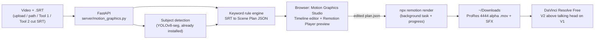

# Tool 4: 🎞️ Motion Graphics Studio — Implementation Plan

Adds a **Mid-Century Kinetic Poster** motion graphics generator to Video Tuxedo, following
[ai_motion_graphics_system_style_guide.md](file:///Users/alexisgonzalez/CodingPower/video-tuxedo/ai_motion_graphics_system_style_guide.md).

**Your decisions so far:**

| Decision | Choice |
| :--- | :--- |
| Format | **9:16 vertical only** (1080×1920) |
| Scene plan source | **Local keyword/rule engine** drafts it → you edit it in a visual timeline |
| SFX | **Synthesized locally** with Python/numpy |
| UX | **New tool card inside Video Tuxedo** (live Remotion preview + one-click ProRes 4444 render) |

---

## 0. Visual Reference: "CARACAS — El Ávila y su Cinetismo" / "Petare y su Modernismo"

The two posters are the visual target. Both are **portrait**, so their composition maps almost 1:1 onto 9:16.

### Layer stack (top → bottom), reused as our vertical layout
| Poster layer | What it shows | Our 9:16 use |
| :--- | :--- | :--- |
| **Title sky** | Flat `skyTeal`. Big wide geometric caps "CARACAS" (crossbar-less A's, medium weight, **no shadow**). Thin tracked caps subtitle | **Zone T** chapter / title cards, clear of the head |
| **Kinetic sky** | Thin vertical cream **Soto lines** fall from the sky over the mountain tops. Flat scalloped cream **clouds** sit at the left/right edges | Animated canopy behind the title; lines shimmer at native fps |
| **Peak** | Faceted Ávila (ochre/terracotta/green, light from the left) with the **Humboldt tower** on top, *or* a **Petare barrio** hill of tiny boxy houses with dark windows and zig-zag stairs | Background plates (`z-frame` / `z-background`) and a compact peak badge |
| **Mid architecture** | **S-curve viaduct** with concrete pillars. **Gego nets** hang under it, **hyperbolic paraboloid nets** sit on poles, a **wire polyhedron**, UCV-style **brutalist slabs** with window strips, a **hypar pavilion** on mushroom columns | Shoulder-wing accents (L/R), pointers, a chapter tracker with a **vintage car + cyclist** following the path |
| **Cruz-Diez wall** | Vertical red/green/blue/cream stripe wall with a 45° diagonal section | Progress bars, emphasis highlights, lower-third caps |
| **Foreground frame** | **Stone masonry wall** in the bottom-left, **foliage** (green + terracotta leaves) in the bottom corners | Decorative corners framing the speaker's shoulders |
| **Texture** | Muted print, paper grain | Scoped `feTurbulence` grain |

### Takeaways that change the plan
1. **Two type tiers.** The poster title is *medium weight with no shadow*. The guide asks for *800 weight with a hard shadow*. Proposal:
   - **Poster Title tier** (on solid teal cards): wide geometric caps, weight ~500–600, no shadow.
   - **Callout tier** (floating over live video): Montserrat 800 with the `4px 4px 0 #12202F` shadow, for legibility.
2. **Procedural, seeded generators.** The barrio houses, facet mountains, clouds and nets are generated from a `seed`. Each video gets fresh but reproducible variations.
3. **Decoration may enter the platform-UI margin; information may not.** Foliage and stone corners can sit low in the frame. Text and cards stay out of it.
4. **Spanish-first titles.** The posters use Spanish copy ("EL ÁVILA Y SU CINETISMO"). Text rendering must handle accents (Á, Ñ) in all fonts.

---

## 1. Architecture Overview



**The key idea:** one **Scene Plan JSON** is the single source of truth. It holds every graphic,
its zone, its timing in frames, its props and its SFX. The rule engine writes it, the timeline UI
edits it, the in-browser Player previews it, and the Remotion CLI renders it. Nothing is
duplicated between preview and final render.

```jsonc
// Scene Plan (abridged)
{
  "fps": 30, "width": 1080, "height": 1920, "durationInFrames": 1800,
  "mode": "z-foreground",               // z-foreground | z-frame | z-background
  "subjectBox": { "x": 210, "y": 470, "w": 660, "h": 1450 }, // auto-detected
  "scenes": [
    { "id": "s1", "component": "BrutalistLowerThird", "zone": "B",
      "from": 45, "durationInFrames": 120,
      "props": { "text": "ALEXIS GONZALEZ", "subtext": "VIDEO TUXEDO" },
      "sfx": [{ "id": "SFX_BRUTAL_THUD", "at": 0 }], "trigger": "srt#1: 'my name is'" }
  ]
}
```

---

## 2. Translating the Style Guide to 9:16 (1080×1920)

The guide's safe zones are written for 16:9. In vertical video the free space is **above the head**
and in the **lower-third band**, while the side wings are narrow. Vertical apps also cover the
bottom and right edges with their own UI. Proposed vertical zones (all tunable in `safeZones.ts`):

```text
 X: 0                    540                  1080
 ┌──────────────────────────────────────────────┐ Y 0
 │ (platform top UI margin ~0–90)               │
 │ ZONE T – Kinetic Canopy / Main Cards         │ Y 90–460   ← primary card zone (replaces Zone L)
 │   X 60–1020                                  │
 ├──────┬──────────────────────────────┬────────┤ Y 470
 │ZONE L│   SUBJECT EXCLUSION ZONE     │ ZONE R │
 │X40–  │   X 210–870, Y 470–1920      │X 870–  │ Y 560–1250 (thin wing accents,
 │ 210  │  ┌────────────────────────┐  │  1000  │  stripes, badges, mesh pointers)
 │      │  │ FACE NO-GO             │  │        │
 │      │  │ X 300–780, Y 520–1050  │  │        │
 │      │  └────────────────────────┘  │        │
 ├──────┴──────────────────────────────┴────────┤ Y 1260
 │ ZONE B – Brutalist Lower Third / Captions    │ Y 1260–1560, X 60–960
 ├──────────────────────────────────────────────┤ Y 1580
 │ PLATFORM UI RESERVED (captions, buttons)     │ Y 1580–1920 + right rail X 960–1080
 └──────────────────────────────────────────────┘ Y 1920
```

- **Dynamic zones:** instead of a fixed `subjectPosition` prop, YOLOv8-seg samples ~10 frames and
  measures the speaker's real bounding box. Zones then **shrink or grow around it**. You can still
  override this manually (`center | high | low`).
- **Component defaults change for vertical:** `AvilaFacetCard` moves from Zone L → **Zone T**,
  `CruzDiezBadge` is used as a compact wing accent in L/R, and `ViaductProgress` runs along the top of Zone T.
- **The 3 depth modes still apply:**
  1. `z-foreground`: transparent overlay on V2 (the default).
  2. `z-frame`: the speaker sits inside a poster cutout in the lower half, with an animated poster above.
  3. `z-background`: the **graphics-behind-speaker sandwich**. Use **Tool 3 (Magic Mask)** ProRes alpha cutout
     on V3 → graphics on V2 → original on V1. This gets you depth without DaVinci Studio.

---

## 3. Proposed Changes

### Phase 1 — Remotion Foundation (`motion-studio/`)
A new TypeScript Remotion project at the repo root. It uses the folder layout from §7 of the guide.

| File | Purpose |
| :--- | :--- |
| [NEW] `motion-studio/package.json` | `remotion`, `@remotion/cli`, `@remotion/player`, `@remotion/paths`, `@remotion/google-fonts` (Montserrat), `esbuild` |
| [NEW] `src/index.ts`, `src/Root.tsx` | Registers the `TalkingHeadOverlay` composition (1080×1920, transparent). `calculateMetadata` derives duration/fps from the plan |
| [NEW] `src/styles/palette.ts` | Strict `PALETTE` + `KINETIC_SPRING` + `steppedFrame()` helper (12–15fps poster feel) |
| [NEW] `src/styles/safeZones.ts` | Vertical zones + platform-UI margins + `resolveZones(subjectBox)` |
| [NEW] `src/styles/typography.ts` | Header/label styles (800 weight, 0.15em tracking, hard `4px 4px 0 #12202F` shadow) |
| [NEW] `src/utils/srtParser.ts` | SRT → `{id, startFrame, endFrame, text, keywords}` |
| [NEW] `src/assets/primitives/` | `PaperGrain` (scoped `feTurbulence` + `feComposite in` for clean alpha), `OpticalStripes` (Cruz-Diez), `SotoLines`, `FacetMountain`, `BrutalBlocks`, `GeoReveal` (clip-path polygon wipe) |
| [NEW] `src/compositions/TalkingHeadOverlay.tsx` | Maps `plan.scenes` → `<Sequence>` + component + `<Audio>` SFX. Shows the source video underneath **only in preview**, never in the render |

### Phase 2 — Component & Sound Library
| File | Purpose |
| :--- | :--- |
| [NEW] `src/assets/components/CruzDiezBadge.tsx` | Octagonal moiré stripe frame + title banner |
| [NEW] `src/assets/components/AvilaFacetCard.tsx` | Faceted-mountain-topped info card with staggered bullets (`SFX_TYPE_CLACK` per bullet) |
| [NEW] `src/assets/components/GegoMeshPointer.tsx` | Parabolic wireframe mesh drawn on via `@remotion/paths` |
| [NEW] `src/assets/components/BrutalistLowerThird.tsx` | Concrete/rust slab + animated stripe cap |
| [NEW] `src/assets/components/ViaductProgress.tsx` | S-curve highway chapter tracker with a node following the path |
| [NEW] `src/assets/components/KineticCaption.tsx` | *(Optional, toggleable)* styled word-by-word SRT captions in Zone B |
| [NEW] `src/assets/components/PosterTitleCard.tsx` | **From posters:** "CARACAS"-style title + subtitle on a teal sky with Soto lines + edge clouds (Zone T) |
| [NEW] `src/assets/components/AvilaPeak.tsx` | **From posters:** faceted mountain + Humboldt tower, seeded facets, stepped-frame rise |
| [NEW] `src/assets/components/PetareHill.tsx` | **From posters:** procedural barrio of boxy houses with windows + zig-zag stairs that "build up" house by house |
| [NEW] `src/assets/components/ViaductSweep.tsx` | **From posters:** S-curve viaduct with pillars + hanging Gego nets. A car/cyclist follows the path (`@remotion/paths`) |
| [NEW] `src/assets/components/CruzDiezWall.tsx` | **From posters:** stripe wall with a diagonal section, used as a progress bar / emphasis slab |
| [NEW] `src/assets/components/HyparNet.tsx` | **From posters:** hyperbolic-paraboloid net on poles + wire polyhedron, used as wing accents |
| [NEW] `src/assets/components/ForegroundFrame.tsx` | **From posters:** stone wall + foliage corners framing the shoulders |
| [NEW] `src/compositions/PosterPlate.tsx` | **From posters:** full poster scene for `z-frame` / `z-background`, with the speaker composited into the road/foreground area |
| [NEW] `src/assets/registry.json` + `REGISTRY.md` | Machine-readable catalog (feeds the UI's Asset Library). `REGISTRY.md` is **generated** from it so the two never drift |
| [NEW] `server/sfx_synth.py` | numpy synthesis of the 5 SFX (paper snap, concrete thud, wire swish, typewriter clack, kinetic hum loop) → `motion-studio/public/sfx/*.wav` |

### Phase 3 — Backend (`server/motion_graphics.py` + endpoints in [app.py](file:///Users/alexisgonzalez/CodingPower/video-tuxedo/server/app.py))
- **Rule engine** (`draft_scene_plan`). Each rule maps keywords/patterns to a component, zone and SFX. Initial rules:
  - Numbers/stats (`%`, `$`, "million", digits) → `CruzDiezBadge` showing the figure
  - Enumerations ("first / second / step / tip #") → one `AvilaFacetCard` that collects the bullets
  - Self-intro ("my name is", "I'm") → `BrutalistLowerThird`
  - Topic shifts ("so / now let's / next") → `ViaductProgress` chapter tick
  - Emphasis ("important / key / never / secret") → stripe highlight
  - Deictic ("look / this / here") → `GegoMeshPointer`
  - **Spacing rules:** at most one graphic per zone at a time, a cooldown between scenes, a minimum on-screen time, and
    nothing ever inside the face no-go box
  - Custom keyword → component rules can be added from the UI and are saved to `rules.json`
- **Subject detection:** reuses the existing YOLOv8-seg model from [magic_mask.py](file:///Users/alexisgonzalez/CodingPower/video-tuxedo/server/magic_mask.py) to compute `subjectBox`.
- **Endpoints:** `POST /api/motion/load` (video + SRT, or auto-transcribe with the existing Whisper pipeline),
  `POST /api/motion/draft-plan`, `GET/PUT /api/motion/plan/{slug}` (saved to `motion-studio/src/videos/[slug]/plan.json`),
  `GET /api/motion/registry`, `POST /api/motion/render` + `GET /progress/{id}` + `POST /cancel/{id}`. The render endpoints
  follow the same background-task pattern as Magic Mask, parsing Remotion's stdout for progress.
- **Render outputs** (auto-saved to `~/Downloads`):
  - **ProRes 4444 `.mov`** (`yuva444p10le`, PNG frames, SFX baked into the audio). Recommended.
  - **PNG sequence + `.wav`** as a fallback.
  - **SFX-only `.wav` stem** for mixing in Fairlight.
  - **H.264 on black** for Screen blend (guide §8 Option B).

### Phase 4 — Frontend (Tool card + Studio view)
| File | Purpose |
| :--- | :--- |
| [NEW] `motion-studio/src/player-entry.tsx` → `static/motion/player.bundle.js` | esbuild bundle exposing `window.MotionPlayer.mount/update/seek`. This lets the vanilla-JS app embed `@remotion/player` without moving to a React app |
| [NEW] [static/js/motion_graphics.js](file:///Users/alexisgonzalez/CodingPower/video-tuxedo/static/js/motion_graphics.js) | `MotionGraphicsStudio` class: load step, plan drafting, timeline editor, inspector, render panel |
| [MODIFY] [index.html](file:///Users/alexisgonzalez/CodingPower/video-tuxedo/static/index.html) | 4th tool card + `motionToolView` section + DaVinci import guide modal |
| [MODIFY] [app.js](file:///Users/alexisgonzalez/CodingPower/video-tuxedo/static/js/app.js) | `#motion` route + launcher bindings |
| [MODIFY] [style.css](file:///Users/alexisgonzalez/CodingPower/video-tuxedo/static/css/style.css) | Studio layout styles, using the existing ivory/terracotta design tokens |

**Studio UI layout:**
- **Left:** 9:16 live Player with the speaker video underneath, plus a toggle for the **safe-zone overlay**.
- **Bottom:** multi-lane timeline (lanes T / L / R / B + SFX). Scene blocks can be dragged, resized and deleted. The SRT cues are shown as a ruler.
- **Right:** inspector (component, zone, text props, colors, SFX) and an Asset Library listing registry components.
- **Header:** depth-mode selector, "Re-draft from SRT", Save plan, and Render.

### Phase 5 — Wiring, Docs & Guide Update
- [MODIFY] [run.sh](file:///Users/alexisgonzalez/CodingPower/video-tuxedo/run.sh): `npm install` + player bundle build on first run. Synthesize SFX if they are missing.
- [MODIFY] [README.md](file:///Users/alexisgonzalez/CodingPower/video-tuxedo/README.md): Tool 4 section, DaVinci import steps, roadmap tick, Node.js 18+ prerequisite.
- [MODIFY] `app.py` health/tools list → version `0.4.0`.
- [MODIFY] style guide: add a **"§3-V Vertical 9:16 Layout"** addendum so your AI-IDE master prompt produces vertical-safe code too.

---

## 4. Verification Plan
1. **Type safety:** `npx tsc --noEmit` on `motion-studio`.
2. **Automated safe-zone test:** render `remotion still` frames at each scene's peak. A Python check then asserts that
   alpha is 0 inside the face no-go box and that no pixels land in the platform-UI reserved area.
3. **Palette lint:** scan the components for any hex value that isn't in `PALETTE`.
4. **Unit tests:** the SRT parser and rule engine, run on a sample SRT in English and Spanish.
5. **Render validation:** `ffprobe` must report `prores` profile 4444, `yuva444p10le`, 1080×1920, and an audio stream.
6. **UI end-to-end:** a browser run-through: load video → draft → edit a scene → preview → render → file appears in `~/Downloads`.

---

## 5. Open Questions

> [!IMPORTANT]
> **Q1 — Spoken language:** Are your videos in **Spanish, English, or both**? The keyword lexicon
> needs to match. I'd ship it bilingual (ES + EN) by default.

> [!IMPORTANT]
> **Q2 — Frame rate:** The guide fixes 30fps. If your phone footage is 29.97/60fps, a 30fps overlay
> slowly drifts out of sync in DaVinci. I recommend **matching the source fps automatically**. OK?

**Q3 — Target platforms:** Are the reserved bottom/right margins (TikTok/Reels/Shorts UI) right for you,
or do you also publish vertical video where those margins aren't needed?

**Q4 — Style guide edit:** May I add the vertical addendum directly to your style guide file, or would you
rather have a separate `vertical_addendum.md`?

**Q5 — Palette extension:** The Petare houses use a **pale powder blue** (and a light sand) that the strict
`PALETTE` doesn't include. Should I add e.g. `barrioBlue: "#9DB8C4"`, or keep the palette strictly as written?

**Q6 — Title font:** For the Poster Title tier, should I match the posters' look (a closer geometric Google Font such as
**Josefin Sans** or **Federo**, medium weight, no shadow), or stay with **Montserrat** everywhere as the guide says?

> [!NOTE]
> **Licensing:** Remotion is free for individuals and companies with ≤3 employees. Larger companies
> need a paid license. The first render also downloads Chrome Headless Shell (~100 MB) once.
