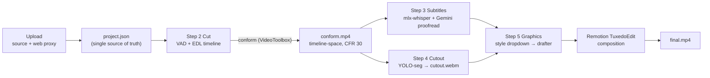

# Tool 5: Tuxedo Editor (end-to-end) — Implementation Plan

A new launcher card that takes one raw talking-head clip all the way to a finished vertical MP4:

**Upload → Cut → Subtitles → Cutout → Graphics → Export**

It reuses the engines we already have (Silero VAD, Whisper, YOLO/SAM masking, Gemini director,
Remotion) and adds the missing piece: a real **non-destructive, CapCut-style timeline** that all
steps share. The Silence Cutter tool gets the same timeline, so both flows improve.

The output targets TikTok / Reels (1080×1920, 30fps, H.264, platform safe zones), but **the app
does not publish anywhere**. You upload the exported file yourself.

---

## 0. Decisions

| # | Topic | Decision | Why |
| :--- | :--- | :--- | :--- |
| D1 | Edit model | **Non-destructive EDL** (ordered clip list over the source file) | Split / delete / reorder / trim are list operations. Nothing is re-encoded until needed. |
| D2 | Timeline behaviour | **Magnetic main track** (like CapCut): deleting closes the gap, dragging inserts and the rest shifts | Matches "all other videos should organize accordingly". |
| D3 | Subtitle AI | **`mlx-whisper` large-v3-turbo** (local, Apple Silicon GPU, free) + **Gemini Flash proofread** (on by default) | Far better than `base`. Gemini key is already in `.env`. Fallback: faster-whisper large-v3-turbo on CPU. |
| D4 | Cutout format | **VP9 WebM with alpha** for preview + render. ProRes 4444 `.mov` only as an on-demand download | Chrome (Remotion Player) cannot decode ProRes. WebM alpha plays in both Player and render. |
| D5 | Graphics styles | **Style dropdown backed by a plugin registry.** Ships with **StoryTuxedo** and **Caracas Kinetic Poster**. New styles plug in without touching the editor | See §6. |
| D6 | Publishing | **None.** Export only | You publish manually. |
| D7 | Storage | **`~/Movies/VideoTuxedo/<slug>/`**, overridable with `VT_PROJECTS_DIR` in `.env` | Outside the repo, next to your other video files. |
| D8 | Downloads | Browser download (`Content-Disposition: attachment`) from the project's `exports/` folder, plus "Show in Finder" | One copy on disk. Exports already live in `~/Movies/VideoTuxedo/<slug>/exports/`. |
| D9 | Frontend | Vanilla JS ES modules under `static/js/editor/`, no new build step | Same stack as the other tools. Only the Remotion Player stays bundled. |

---

## 0.1 Browser & Media Sync Engineering Principles (The 5 Golden Rules)

Building an interactive timeline and media-compositing pipeline in the browser has classic performance, playback, and synchronization pitfalls. We enforce these 5 strict architectural rules across the codebase:

1. **Audio Pops on Jump Cuts (`conform.py`):**
   Hard-cutting speech segments back-to-back in FFmpeg (`render_conform`) creates audible zero-crossing clicks/pops at clip boundaries—especially with tight speech padding (`0.12s`).
   - **Rule:** In `server/editor/conform.py`, apply a micro audio crossfade (`acrossfade=d=0.015:c1=tri:c2=tri` or 10–15ms `afade` in/out per segment) during the `h264_videotoolbox` filtergraph concat so every jump cut sounds studio-smooth.

2. **Viewport-Sized Canvas & Pointer Capture (`Timeline.js`):**
   Rendering a 20,000px-wide canvas or thousands of DOM tick marks for waveforms and rulers chokes browser layout engines when zoomed in to frame-level on a 3-minute clip.
   - **Rule:** Keep DOM-based blocks for Clips, Subtitles, and Layers, but render the Ruler and Waveform (`peaks.json`) onto a **single viewport-sized `<canvas>`** that redraws on horizontal scroll and zoom.
   - **Rule:** Call `element.setPointerCapture(e.pointerId)` on edge trim handles (`VideoTrack.js`, `CaptionTrack.js`) so fast mouse dragging outside track bounds or window edges never loses the drag state.

3. **Step 2 Browser Preview Decoder Optimization (`media.py` & `TuxedoEdit.tsx`):**
   If a 3-minute raw clip has 45 silence cuts, mounting 45 `<Sequence><OffthreadVideo/></Sequence>` tags inside the browser preview hits Chrome's hardware video decoder limit and causes severe memory spikes.
   - **Rule:** During interactive browser preview in `MotionPlayer`, use Remotion's standard `<Video>` (or `<Html5Video>`) with `premountFor={15}`, and reserve `<OffthreadVideo>` strictly for headless CLI renders (`Remotion.getRemotionEnvironment().isRendering`).
   - **Rule:** Encode `source_web.mp4` with a short GOP (`-g 15` / keyframe every 0.5s) so a single video element seeking across EDL cut points in the browser is instantaneous.

4. **External SVG Transform Gizmos with Throttled RAF & PointerUp Undo (`player.js`):**
   Embedding interactive transform gizmos (drag/scale/rotate) inside the Remotion composition causes render thrashing and state desyncs.
   - **Rule:** Render a transparent SVG/HTML gizmo overlay on top of the `MotionPlayer` container in `player.js`, mapped to 1080×1920 coordinates via CSS scaling.
   - **Rule:** On `pointermove`, update the gizmo DOM directly and throttle `MotionPlayer.updateProps()` via `requestAnimationFrame`.
   - **Rule:** On `pointerup`, commit a single `{do, undo}` command to `store.js` so intermediate drag frames never pollute the undo stack.

5. **Hash-Based Cache Invalidation (`conform.mp4` / `cutout.webm`):**
   When the user trims a clip and re-conforms or re-rotoscopes, the filename inside `~/Movies/VideoTuxedo/<slug>/` remains `conform.mp4` or `cutout.webm`. Both Chrome and Remotion's asset loader aggressively cache video buffers by URL.
   - **Rule:** Always append `?v=${project.conform.hash}` and `?v=${project.cutout.conformHash}` to media URLs passed into `TuxedoEdit` props so the Remotion Player immediately invalidates stale video buffers after a re-render.

---

## 1. Architecture



**The key idea:** `project.json` holds the clip list, the words, the subtitle cues, the image layers
and the graphics. The timeline UI edits it, the Remotion Player previews it, the Remotion CLI
renders it. Nothing is duplicated between preview and render.

### 1.1 Time spaces (the part that keeps edits from breaking later steps)

| Data | Stored in | Why |
| :--- | :--- | :--- |
| Clips | **source time** (`srcIn`, `srcOut`), list order = timeline order | That is what an EDL is. |
| Words + subtitle cues | **source time** | If you go back to Step 2 and reorder or delete, subtitles follow their clip automatically. Cues that cross a cut are split at render time. |
| Image layers, graphics | **timeline time** | An image that spans three jump cuts must stay one continuous layer. |
| Cutout mask | tied to `conformHash` | If the cut changes, the mask is marked stale and the UI offers a re-run. |

Mapping (one function, used in Python and JS):

```text
clipStart[i] = Σ (srcOut − srcIn) for clips before i
timeline(t_src) = clipStart[i] + (t_src − clip[i].srcIn)   for the clip i that contains t_src
```

All times snap to the frame grid (`1/fps`). Minimum clip length is 2 frames.

### 1.2 Project folder

```text
~/Movies/VideoTuxedo/
└── mi-historia-del-metro_1761000000/
    ├── project.json
    ├── source.mov            original upload (untouched)
    ├── source_web.mp4        H.264/AAC proxy when the source is HEVC/ProRes/.mov
    ├── peaks.json            waveform peaks
    ├── conform.mp4           cut timeline, CFR 30
    ├── cutout.webm           subject with alpha
    ├── images/               image layer assets
    ├── cache/                VAD, transcript, subject track, Gemini responses
    └── exports/              everything you download
```

Remotion reaches project media through a symlink:
`motion-studio/public/projects/<slug>` → `~/Movies/VideoTuxedo/<slug>` (same approach as
`stage_media_for_remotion`, which already symlinks into `public/`).

### 1.3 `project.json` schema (v1)

```jsonc
{
  "version": 1,
  "slug": "mi-historia-del-metro_1761000000",
  "name": "Mi historia del metro",
  "createdAt": "...", "updatedAt": "...",
  "step": 3,                          // furthest step reached
  "fps": 30, "width": 1080, "height": 1920,
  "source": { "file": "source.mov", "webFile": "source_web.mp4", "duration": 182.4, "rotation": 90, "hasAudio": true },
  "silence": { "minSilence": 0.45, "padding": 0.12, "threshold": 0.5 },
  "clips": [ { "id": "c_01", "srcIn": 0.84, "srcOut": 4.12 } ],
  "conform": { "file": "conform.mp4", "hash": "sha1-of-clips", "duration": 121.3 },
  "transcript": {
    "engine": "mlx-whisper/large-v3-turbo", "language": "es", "glossary": ["Petare", "pana"],
    "proofread": true,
    "words": [ { "id": "w_0001", "text": "Bueno,", "srcStart": 0.90, "srcEnd": 1.20, "p": 0.98 } ]
  },
  "captions": {
    "enabled": true,
    "cues": [ { "id": "s_001", "srcStart": 0.90, "srcEnd": 2.40, "text": "Bueno, les cuento", "wordIds": ["w_0001","w_0002","w_0003"] } ],
    "style": { "preset": "tuxedo-bold", "font": "Montserrat", "size": 72, "color": "#FFFFFF",
               "highlight": "#FACC15", "position": "lower-third", "maxWordsPerLine": 4, "karaoke": true }
  },
  "cutout": { "file": "cutout.webm", "conformHash": "...", "target": "person", "feather": 3, "expand": 0 },
  "layers": [ { "id": "img_01", "src": "images/sol.png", "start": 3.0, "end": 6.5,
                "z": "behind", "x": 540, "y": 520, "scale": 1.0, "rotation": 0, "opacity": 1,
                "enter": "pop", "exit": "fade" } ],
  "graphics": {
    "style": "story_tuxedo",          // id from the style registry (§6)
    "settings": { },                  // style-level settings, shape defined by the style
    "items": [                        // normalized items, same shape for every style
      { "id": "g_01", "component": "KineticTitleBehind", "start": 12.4, "end": 14.6,
        "layer": "behind", "placement": { "position": "top" },
        "props": { "headlineText": "TRÁGAME TIERRA", "emojiOrIcon": "💀", "accentColor": "#F43F5E" },
        "sfx": [ { "file": "vine_boom.mp3", "at": 0, "volume": 0.4 } ],
        "source": "gemini" }
    ],
    "meta": { "storyHook": "" }
  },
  "export": { "lastFile": "exports/final.mp4" }
}
```

---

## 2. UI and design rules (applies to the whole card)

The current tools have too many buttons competing for attention. The new card follows these rules,
and Phase 7 applies them to the existing tools.

1. **One primary button per view.** Terracotta `--accent-coral`, always bottom-right: "Continue",
   "Generate subtitles", "Export". Everything else is secondary (outline) or ghost (text).
2. **No emoji in buttons or headings.** Use one inline-SVG icon set (Lucide-style, 1.5px stroke).
3. **Sentence case labels**, short verbs: "Cut silences", "Split", "Delete". No exclamation marks.
4. **Toolbar = icon buttons** (32px, tooltip with shortcut). Labels only where meaning is unclear.
5. **Downloads live in one menu per step** ("Download ▾"), not as five separate buttons.
6. **Ivory chrome, charcoal stage.** Page, inspector and step rail use the existing ivory tokens.
   Player and timeline sit on `--bg-dark` (#141413) so the video and clips have contrast.
7. **Progress inline, not modal.** Long tasks show a thin bar plus a status line in the inspector,
   with Cancel as a ghost button.
8. **Motion:** 150–200ms ease-out on hover and selection only. No bouncing UI.

### Layout

```text
┌──────────────────────────────────────────────────────────────────────────┐
│ ← Tools   Mi historia del metro  · Saved        1 Upload ─ 2 Cut ─ 3 ... │  step rail
├───────────────────────────────┬──────────────────────────────────────────┤
│                               │  Inspector (contextual for the step)     │
│      9:16 Remotion Player     │  - settings                              │
│      (charcoal stage)         │  - selected item properties              │
│      [safe zones] toggle      │  - task progress                         │
├───────────────────────────────┴──────────────────────────────────────────┤
│ ▶  00:12.04 / 02:01.30   [split][delete][undo][redo]   [snap] [− zoom +] │  toolbar
│ ┃ ruler ─────────────────────────────────────────────────────────────── │
│ ┃ Graphics   ▭▭    ▭▭▭        ▭                                           │  step 5+
│ ┃ Overlays     ▭▭▭▭▭                                                      │  step 4+
│ ┃ Subtitles ▭▭ ▭▭▭ ▭ ▭▭▭ ▭▭ ▭▭▭▭ ▭▭                                       │  step 3+
│ ┃ Video     [clip][clip][clip ~waveform~][clip]                           │  always
├──────────────────────────────────────────────────────────────────────────┤
│ Download ▾   Show in Finder                             Back   Continue  │  footer
└──────────────────────────────────────────────────────────────────────────┘
```

### Keyboard shortcuts (shared timeline)

| Key | Action |
| :--- | :--- |
| `Space` | Play / pause |
| `S` | Split selected item at playhead (clip or subtitle) |
| `Delete` / `Backspace` | Delete selected (ripple on video track) |
| `M` | Merge subtitle with next |
| `⌘Z` / `⇧⌘Z` | Undo / redo |
| `←` / `→` | Step 1 frame (`⇧` = 1 second) |
| `+` / `−` | Zoom timeline |
| `N` | Toggle snapping |

---

## 3. Shared building blocks (Phase 1)

### 3.1 Backend: `server/editor/` package (new)

Kept out of `app.py`, which is already 1,266 lines. Mounted with one `app.include_router(...)` line.

| File | Responsibility |
| :--- | :--- |
| `server/editor/__init__.py` | Exports `router`. |
| `server/editor/paths.py` | `PROJECTS_DIR = Path(os.environ.get("VT_PROJECTS_DIR", "~/Movies/VideoTuxedo")).expanduser()`, slug generation, path-traversal-safe file resolution, Remotion symlink management. |
| `server/editor/project.py` | `Project` pydantic model (§1.3), load/save with atomic write, `edl_hash()`, `src_to_timeline()`, `timeline_to_src()`, `map_cues_to_timeline()` (splits cues across cuts). |
| `server/editor/tasks.py` | Generic `TaskRegistry` (start thread, progress dict, cancel flag). Replaces the copy-pasted `_MOTION_TASKS` / `_MAGIC_MASK_TASKS` pattern for this tool. |
| `server/editor/media.py` | Probe, web proxy (`source_web.mp4` with short GOP `-g 15` / 0.5s keyframes so single video elements seek instantaneously across EDL cuts), waveform peaks (`peaks.json`, 100 values/s, reuses `extract_audio_for_vad` audio), optional filmstrip sprite. |
| `server/editor/conform.py` | `render_conform(project)`: ordered trim+concat with `h264_videotoolbox`, CFR 30, AAC with micro audio crossfade (`acrossfade=d=0.015:c1=tri:c2=tri` or 10–15ms `afade` per segment) to eliminate zero-crossing audio pops. Writes to project folder and reports progress (`-progress pipe:1`). |
| `server/editor/captions_ai.py` | Transcription + proofreading (§5). |
| `server/editor/styles/` | Graphics style registry and drafters (§6). |
| `server/editor/exports.py` | Per-step export builders (§8). |
| `server/editor/routes.py` | All `/api/editor/*` endpoints (§9). |

### 3.2 Remotion: one composition for preview and render

| File | Change |
| :--- | :--- |
| `motion-studio/src/editSchema.ts` (new) | Zod schema for the subset of `project.json` the composition needs (clips, mode, captions in timeline time, layers, graphics, cutout file). |
| `motion-studio/src/compositions/TuxedoEdit.tsx` (new) | Layer stack: **base video → behind images → style background (e.g. Caracas plate) → behind graphics → cutout → front images → front graphics → captions**. Base video has two modes: `edl` (browser preview uses `<Video premountFor={15}>` over short-GOP `source_web.mp4` to prevent hardware decoder exhaustion; `<OffthreadVideo>` reserved for headless CLI renders) and `flat` (`conform.mp4`). Appends cache-busting query strings (`?v=${project.conform.hash}`, `?v=${project.cutout.conformHash}`) to media URLs so Chrome and Remotion never reuse stale decoded video buffers after re-conforming or re-masking. |
| `motion-studio/src/components/EditCaptions.tsx` (new) | Renders cue pages with optional karaoke word highlight. Spring in/out per `.cursorrules`. Respects safe zones from `styles/safeZones.ts`. |
| `motion-studio/src/components/ImageLayer.tsx` (new) | Positioned image with frame-driven enter/exit (`pop`, `slide-up`, `fade`, `none`). |
| `motion-studio/src/graphicStyles/` (new) | Style renderers (§6.3). |
| `motion-studio/src/Root.tsx` | Register `TuxedoEdit` with `calculateMetadata` (duration = Σ clips, or conform duration). |
| `motion-studio/src/player-entry.tsx` | **Refactor `MotionPlayer` from a singleton to `MotionPlayer.create(container) → instance`.** Today there is one global React root and one `__activePlayer`, so two views cannot each have a player. Keep the old `mount/update/seek` global API as a shim for Motion Graphics Studio. Add `TuxedoEdit` to the component switch. |

### 3.3 Frontend: `static/js/editor/` (new, ES modules)

| File | Responsibility |
| :--- | :--- |
| `editor.js` | `TuxedoEditor` controller: step rail, loads/saves project (debounced autosave 800ms, "Saving… / Saved"), mounts the player, routes to step modules. |
| `store.js` | Project state + **command-based undo/redo** (each edit is `{do, undo}`), change events. |
| `edl.js` | Pure functions: `split`, `remove`, `move`, `trim`, `clipStarts`, `srcToTimeline`, `timelineToSrc`, `snapToFrame`. Mirrors `project.py`. |
| `timeline/Timeline.js` | DOM timeline with 4 fixed tracks. **Ruler and Waveform (`peaks.json`) rendered onto a single viewport-sized `<canvas>`** that redraws on horizontal scroll and zoom (avoids 20,000px canvases that choke browser layout engines). Track registry, selection, snapping engine (playhead, clip edges, word boundaries, other items; 8px threshold). |
| `timeline/VideoTrack.js` | Clip blocks with waveform slice. Drag-to-reorder with insertion marker. Edge trim handles use `element.setPointerCapture(e.pointerId)` so fast dragging outside track bounds never loses drag state. Ripple delete. |
| `timeline/CaptionTrack.js` | Cue blocks: drag body to move, drag edges to retime (with `element.setPointerCapture(e.pointerId)`), split at playhead by word, merge, no-overlap clamping, min 0.2s. |
| `timeline/LayerTrack.js` | Generic timed blocks for image layers and graphics items (move, trim, delete). |
| `player.js` | Wraps `MotionPlayer.create`, frame ↔ seconds, syncs playhead both ways, safe-zone overlay toggle. **Mounts transparent SVG/HTML transform gizmo overlay on top of player container (outside Remotion)**, mapped to 1080×1920 coordinates via CSS scaling. Throttles `updateProps` via `requestAnimationFrame` on `pointermove`, commits a single `{do, undo}` command to `store.js` on `pointerup`. |
| `inspector/SchemaForm.js` | Renders an edit form from a JSON prop schema. Used by the graphics inspector so each style's components get controls without custom UI code. |
| `ui.js` | Small shared components: `dropdownMenu`, `iconButton`, `progressLine`, `select`, toast (reuse `window.showToast`). |
| `steps/upload.js`, `cut.js`, `subtitles.js`, `cutout.js`, `graphics.js`, `export.js` | One module per step: inspector panel + which tracks are visible + footer actions. |

`static/index.html` gets a sixth launcher card ("Tuxedo Editor") and an `#editorToolView`
section. `static/js/app.js` gets the `editor` route (`#editor`). `static/css/editor.css` (new)
holds the editor styles, built on the existing tokens in `style.css`.

---

## 4. Step-by-step

### Step 1 — Upload

- Drag-and-drop zone + "Choose file" (secondary) + "Use a file path" (ghost, for huge files, reuses
  the existing path-loading pattern).
- The upload streams into `~/Movies/VideoTuxedo/<slug>/source.<ext>`. On completion the server
  probes the file, builds `source_web.mp4` if needed (iPhone HEVC `.mov`), writes `peaks.json` and
  starts **silence detection in the background** so Step 2 opens instantly.
- "Recent projects" list under the drop zone (name, duration, last step, thumbnail) to resume work.
  Each row has a "…" menu: Rename, Show in Finder, Delete.
- **Download:** original file.
- **Primary:** Continue.

### Step 2 — Cut

- On entry the inspector shows detected silence stats and three sliders (minimum silence,
  padding, sensitivity). Changing them re-runs VAD (fast, audio already decoded and cached).
- **Primary: "Cut silences"** replaces the clip list with the speech segments (one undoable command).
  Before that, the timeline shows the full source as one clip with silences shaded, so the user
  sees what will go.
- Timeline edits (video track): **split** at playhead, **delete** (ripple), **drag to reorder**
  (others shift), **trim edges** (extend into removed audio if VAD cut a syllable). Edge trim handles use `element.setPointerCapture(e.pointerId)` so fast drags outside the track never drop state.
- Preview: `TuxedoEdit` in `edl` mode uses Remotion `<Video premountFor={15}>` over short-GOP `source_web.mp4` (`-g 15`), so every edit is visible immediately with zero decoder exhaustion.
- **Continue** triggers **conform** if `edl_hash` changed (background task, inline progress,
  typically faster than real time on VideoToolbox). `render_conform` inserts micro audio crossfades (`acrossfade=d=0.015:c1=tri:c2=tri` or 10–15ms `afade` per segment) so jump cuts have zero-crossing smoothing with zero audible pops. Steps 3+ use `conform.mp4?v=${project.conform.hash}` to ensure Remotion and Chrome never reuse stale cached video buffers.
- If later steps exist and the cut changes: subtitles remap automatically (source-time anchors),
  the cutout is marked stale, image layers and graphics keep their timeline position and the UI
  shows one banner: "The cut changed. Review overlays and re-run the cutout."
- **Downloads:** cut MP4 (= conform), takes ZIP, DaVinci XML / FCPXML / EDL. Existing exporters
  in `silence_cutter.py` accept the ordered clip list; `rec_start/rec_end` are recomputed from list
  order before calling them (today they assume chronological order).

### Step 3 — Subtitles

- Inspector: language (default `es`), **glossary** (names and slang passed to Whisper as
  `initial_prompt` and to Gemini as protected terms), pacing preset (punchy / natural / broadcast),
  "Proofread with Gemini" toggle (on).
- **Primary: "Generate subtitles"** runs §5 on `conform.mp4` and stores words in source time.
- Editing, CapCut-style:
  - Cue list in the inspector (click to seek, edit text inline, Enter splits at cursor).
  - Caption track: move, retime edges (with `setPointerCapture`), split at playhead (`S`), merge (`M`), delete.
  - Snapping to word boundaries makes retiming precise without frame-hunting.
  - Live preview of the styled captions in the Player.
- Style panel: 4 presets (Tuxedo bold, Clean, Karaoke yellow, Boxed), font, size, colour,
  highlight colour, position (top / middle / lower third), max words per line.
- If the user edits a cue's text, karaoke timing redistributes across the new words proportionally.
- **Downloads:** SRT, VTT, word-level JSON, and "MP4 with burned-in subtitles" (Remotion render of
  `TuxedoEdit` with captions only).

### Step 4 — Cutout (rotoscoping + images behind the subject)

- **Primary: "Isolate subject"** runs the existing YOLOv8-seg person pipeline on `conform.mp4`.
  New export mode `webm_alpha` in `magic_mask.rotoscope_and_render_video`
  (`libvpx-vp9`, `yuva420p`, `-deadline realtime -cpu-used 8 -row-mt 1`) and a new
  `output_dir` argument so it writes into the project instead of `~/Downloads`.
- Remotion Player loads `cutout.webm?v=${project.cutout.conformHash}` to prevent stale mask caching.
- Optional "Refine" opens a single-frame click picker (positive/negative points) reusing
  `/api/magic-mask/segment-preview`, for when the auto person mask is wrong. Object (SAM 2) mode
  stays available behind it.
- "Show mask" toggle overlays the matte on the preview.
- **Image layers & transform handles:**
  - "Add image" (PNG/JPG/WebP, stored in the project's `images/`).
  - Each layer: behind / in front of subject, start/end (Overlays track).
  - **Direct manipulation on the preview:** Rendered as an external transparent SVG/HTML transform gizmo in `player.js` on top of the player container (not inside Remotion), scaled to 1080×1920 coordinates. Drag to move, corner handles to scale, rotation handle. Numeric fields in the inspector for precision.
  - **Interaction performance & undo polish:** On `pointermove`, updates the gizmo DOM directly and throttles `MotionPlayer.updateProps()` with `requestAnimationFrame`. On `pointerup`, commits a single `{do, undo}` command to `store.js` so intermediate drag frames never flood the undo stack.
  - Behind-subject is the default, which gives the "object passes behind me" effect.
- **Downloads:** cutout ProRes 4444 `.mov` (on demand, existing HW path), cutout WebM, matte MP4,
  composite MP4 (video + images + cutout).

### Step 5 — Motion graphics

- **Style dropdown** at the top of the inspector, filled from `GET /api/editor/styles`
  (label + one-line description + preview thumbnail). Ships with:
  - **StoryTuxedo**: comedic 3-layer cues (kinetic titles behind you, punchline popups in front).
  - **Caracas Kinetic Poster**: Mid-Century poster components (Ávila, Petare, Cruz-Diez, Soto
    lines), zone-aware placement around the subject, optional background plate.
- Below it, **style settings** rendered from the style's settings schema (Caracas: depth mode,
  plate variant, title, subtitle, seed; StoryTuxedo: accent palette, SFX volume). Plus a shared
  "Draft with Gemini" toggle (off = local rule engine).
- **Primary: "Generate graphics"** calls the selected style's drafter with the timeline-space
  words from the edited captions (graphics follow your corrected text).
- Switching style when items exist asks once: "Replace current graphics with <style>?" The
  replacement is a single undoable command.
- Graphics track shows every item. The inspector edits the selected item with `SchemaForm` built
  from the component's prop schema (text, colour, emoji, position/zone, layer, SFX). Same
  move/trim/delete interactions as other tracks. "Add graphic" (ghost) offers the current style's
  component list and inserts at the playhead.
- **Downloads:** graphics overlay ProRes 4444 `.mov` for DaVinci (overlays only, transparent),
  composite MP4, `graphics.json`.

### Step 6 — Export

- Summary card: duration, size estimate, and what is included (subtitles / cutout / images /
  graphics), each with a checkbox.
- Pre-flight checks shown as quiet warnings, never blockers: text inside platform UI zones,
  duration over 10 minutes, stale cutout.
- **Primary: "Export MP4"**: Remotion render of `TuxedoEdit` in `flat` mode, H.264 1080×1920, 30fps,
  CRF 18, AAC 192k, `+faststart`. Progress inline, cancel available.
- **Downloads:** final MP4, final MOV (ProRes 422 HQ for archive), SRT, project bundle ZIP
  (project.json + all assets). "Show in Finder" opens `exports/`.

---

## 5. Better subtitles, free

Pipeline in `server/editor/captions_ai.py`:

1. **Transcribe** `conform.mp4` with `mlx-whisper` model `mlx-community/whisper-large-v3-turbo`
   (`word_timestamps=True`, `language`, `initial_prompt` from glossary). Runs on the Apple
   Silicon GPU. First run downloads about 1.6 GB.
   *Fallback:* faster-whisper `large-v3-turbo`, `int8`, CPU, if `mlx-whisper` is unavailable.
2. **Map** word times from conform time to source time through the EDL. Store them in `transcript.words`.
3. **Proofread** with Gemini Flash (same model and key as `director_agent.py`, structured output).
   The model receives indexed words plus the glossary and returns only corrections as
   `{index, text}` plus optional merges. **It never returns timings**, so alignment cannot drift.
   It fixes spelling, accents, punctuation and casing, and keeps Venezuelan slang. Responses are
   cached in `cache/` per transcript hash. On error or rate limit it falls back silently to the
   raw transcript and the UI notes "Proofread skipped".
4. **Segment** into cues with the existing `build_aligned_phrases` (pacing presets), then split any
   cue that crosses a clip boundary.

Only transcript text goes to Gemini, never media.

---

## 6. Graphics style system

Goal: StoryTuxedo and Caracas behave the same in the editor, and a new style is a contained
addition, not an editor rewrite.

### 6.1 Normalized graphics item

Every style produces the same item shape (see `graphics.items` in §1.3):

| Field | Meaning |
| :--- | :--- |
| `component` | Component id inside the style |
| `start`, `end` | Timeline seconds (the timeline only needs these) |
| `layer` | `behind` (under the cutout) or `front` |
| `placement` | Style-specific: StoryTuxedo `{position}`, Caracas `{zone: T/L/R/B/FULL}` |
| `props` | Component props, validated by the component's schema |
| `sfx` | `[{file, at, volume}]`, `at` in frames from item start |

The timeline, undo/redo, snapping and the inspector work on this shape and never need to know the
style.

### 6.2 Backend: `server/editor/styles/`

| File | Role |
| :--- | :--- |
| `base.py` | `GraphicsStyle` protocol: `id`, `label`, `description`, `thumbnail`, `settings_schema`, `components()` → `[{id, label, defaultLayer, defaultDuration, propSchema}]`, `draft(words, cues, project, settings, use_gemini) → items`. |
| `__init__.py` | `STYLES` registry dict and `get_style(id)`. Adding a style = one import line here. |
| `story_tuxedo.py` | Wraps `director_agent.generate_director_plan` (Gemini or local fallback). Converts `VisualCue` → items (`layer: behind_subject → behind`). Prop schemas mirror `schema.ts`. |
| `caracas.py` | Wraps `motion_graphics.draft_scene_plan_from_srt` + `track_subject_motion` (on `conform.mp4`, cached). Converts frame-based scenes → items, `zone` → `placement`. Depth mode maps to layer: `z-foreground` → front, `z-frame`/`z-background` → behind. Component prop schemas come from the existing `motion-studio/src/assets/registry.json`. Stores `subjectTrack` in `graphics.settings` for the renderer. |

### 6.3 Remotion: `motion-studio/src/graphicStyles/`

| File | Role |
| :--- | :--- |
| `index.ts` | `GRAPHIC_STYLES: Record<string, { Layer, Background? }>` |
| `storyTuxedo/Layer.tsx` | Renders items for one layer. Uses `CueRenderer`, extracted from `MainVideo.tsx` (`MainVideo` keeps working by importing it). |
| `caracas/Layer.tsx` | Converts items back to `Scene`s and reuses the zone resolution and component switch, extracted from `TalkingHeadOverlay.tsx` into `caracas/SceneRenderer.tsx` (`TalkingHeadOverlay` keeps working by importing it). |
| `caracas/Background.tsx` | `PosterPlate` when depth mode is `z-background`, placed under the cutout. Pairs well with Step 4: the plate sits behind you. |

`TuxedoEdit` renders `Background` (if any), then `Layer layer="behind"` under the cutout and
`Layer layer="front"` above it.

### 6.4 Adding a new style (checklist)

1. `server/editor/styles/<id>.py` implementing `GraphicsStyle` (drafter + component schemas).
2. Register it in `server/editor/styles/__init__.py`.
3. `motion-studio/src/graphicStyles/<id>/Layer.tsx` (+ optional `Background.tsx`) and components,
   following `.cursorrules`.
4. Register it in `graphicStyles/index.ts`, run `npm run build:player`.
5. Add a thumbnail at `static/img/styles/<id>.png`.

The dropdown, inspector, timeline and export pick it up automatically.

---

## 7. Silence Cutter tool upgrade (the other flow)

`static/js/silence_cutter.js` keeps its page but swaps its static cut map for the shared
`Timeline` + `VideoTrack` + player. Users get split / delete / reorder / trim there too. Its export
endpoints receive the ordered clip list with recomputed `rec_start/rec_end`. No backend rewrite.

All new Remotion components follow `.cursorrules`: motion only from `useCurrentFrame()`, clamped
`interpolate`, enter and exit springs, `<OffthreadVideo>` + `staticFile()` only, safe zones
(no text in the bottom 380px, nothing in the right 140px between y 700–1500).

---

## 8. Downloads per step

| Step | Files |
| :--- | :--- |
| 1 Upload | original |
| 2 Cut | cut `.mp4`, takes `.zip`, DaVinci `.xml` / `.fcpxml` / `.edl` |
| 3 Subtitles | `.srt`, `.vtt`, words `.json`, burned-in `.mp4` |
| 4 Cutout | cutout `.mov` (ProRes 4444), cutout `.webm`, matte `.mp4`, composite `.mp4` |
| 5 Graphics | overlay `.mov` (ProRes 4444), composite `.mp4`, `graphics.json` |
| 6 Export | final `.mp4`, archive `.mov` (ProRes 422 HQ), `.srt`, project bundle `.zip` |

One endpoint: `POST /api/editor/projects/{slug}/exports/{kind}` returns a task id for heavy
renders, or the file directly for light ones (SRT, JSON, XML). Every file lands in the project's
`exports/` folder and is then sent to the browser as a download.

---

## 9. API surface (`/api/editor`)

| Method | Path | Purpose |
| :--- | :--- | :--- |
| `GET` | `/projects` | Recent projects |
| `POST` | `/projects` | Create from upload (multipart) or path |
| `GET` / `PUT` | `/projects/{slug}` | Load / autosave `project.json` |
| `PATCH` | `/projects/{slug}/name` | Rename |
| `DELETE` | `/projects/{slug}` | Move project folder to the Trash |
| `POST` | `/projects/{slug}/reveal` | Show in Finder (`open -R`) |
| `GET` | `/projects/{slug}/peaks` | Waveform peaks |
| `GET` | `/projects/{slug}/files/{path}` | Serve project media (range requests) |
| `POST` | `/projects/{slug}/silence` | Detect with given settings → speech clips |
| `POST` | `/projects/{slug}/conform` | Render `conform.mp4` → task |
| `POST` | `/projects/{slug}/transcribe` | Transcribe + proofread → task |
| `POST` | `/projects/{slug}/captions/resegment` | Re-run pacing on words |
| `POST` | `/projects/{slug}/cutout` | Rotoscope to WebM alpha → task |
| `POST` | `/projects/{slug}/images` | Upload image layer asset |
| `GET` | `/styles` | Style registry: ids, labels, settings schemas, component schemas |
| `POST` | `/projects/{slug}/graphics` | Draft graphics with `{style, settings, useGemini}` → task |
| `POST` | `/projects/{slug}/exports/{kind}` | Any download in §8 |
| `GET` | `/tasks/{id}` · `POST` `/tasks/{id}/cancel` | Task progress / cancel |

---

## 10. Phases (each one is testable on its own)

| Phase | Scope | You can test |
| :--- | :--- | :--- |
| **1. Foundation** | `server/editor/` skeleton, `~/Movies/VideoTuxedo` storage, project model + persistence, task registry, web proxy with short GOP (`-g 15`), launcher card, `#editor` route, step rail, `editor.css`, `MotionPlayer.create` refactor, `TuxedoEdit` composition (base video only, cache-busting URLs) | Upload a video (including an iPhone `.mov`), see it in the 9:16 player, find the folder in `~/Movies/VideoTuxedo`, reload the page and the project is still there. Motion Graphics Studio still works. |
| **2. Timeline + Cut** | `edl.js`, `store.js` undo/redo, `Timeline` with viewport-sized ruler/waveform canvas, `VideoTrack` with `setPointerCapture` trim handles, VAD settings, "Cut silences", split/delete/reorder/trim, `edl` preview mode (`<Video premountFor={15}>`), conform task with 15ms audio crossfade (`acrossfade`), Step 2 downloads | Cut silences, split a clip, drag it to the start, delete one, undo, watch the result smoothly with zero audio pops or decoder lag, download the MP4 and the DaVinci XML. |
| **3. Subtitles** | `captions_ai.py` (mlx-whisper + Gemini proofread), `CaptionTrack` (with `setPointerCapture`), cue list editor, style presets, `EditCaptions.tsx`, Step 3 downloads | Generate, fix a word, split a cue, drag its edge, change the style, download SRT and burned-in MP4. Go back to Step 2, delete a clip, and the subtitles follow. |
| **4. Cutout + images** | `webm_alpha` + `output_dir` in `magic_mask.py`, refine picker, image upload, `LayerTrack`, on-canvas external SVG transform gizmo with RAF throttling & single-command pointerup undo, `ImageLayer.tsx`, Step 4 downloads | Isolate yourself, drop a PNG behind you, move and scale it with on-canvas handles, undo in one step, download the composite. |
| **5. Graphics styles** | Style registry (backend + Remotion), StoryTuxedo and Caracas adapters, extraction of `CueRenderer` and `SceneRenderer`, style dropdown + settings, `SchemaForm` inspector, graphics track, Step 5 downloads | Pick StoryTuxedo, generate, edit an item. Switch to Caracas with a background plate behind you, generate, move an item. Export the overlay MOV. |
| **6. Export** | Final render, pre-flight warnings, archive MOV, project bundle ZIP, Show in Finder | Export the final MP4 and play it in QuickTime; open the bundle ZIP. |
| **7. Silence Cutter + polish** | Shared timeline inside the Silence Cutter tool. Apply §2 design rules to the existing tool views (button hierarchy, emoji removal, download menus) | Old tool has the new timeline; the UI looks consistent across tools. |

New dependency: `mlx-whisper` (Python). No new npm packages.
`.gitignore` addition: `motion-studio/public/projects` (project data lives outside the repo).

---

## 11. Risks

| Risk | Mitigation |
| :--- | :--- |
| Audio zero-crossing clicks/pops on jump cuts in `conform.mp4` | In `server/editor/conform.py`, apply a micro audio crossfade (`acrossfade=d=0.015:c1=tri:c2=tri` or 10–15ms `afade` per segment) during `h264_videotoolbox` concat so jump cuts sound studio-smooth. |
| Remotion Player hits Chrome hardware decoder limit / memory spikes on 40+ cuts in `edl` mode | Use Remotion's `<Video premountFor={15}>` (or `<Html5Video>`) in browser preview, reserving `<OffthreadVideo>` strictly for headless CLI renders (`isRendering`). Encode `source_web.mp4` with a short GOP (`-g 15` / keyframe every 0.5s) for instant seeking. |
| Browser layout engine chokes on wide 20,000px canvas when zoomed in to frame-level | Render ruler and waveform (`peaks.json`) onto a **single viewport-sized `<canvas>`** that redraws on horizontal scroll and zoom; use DOM blocks for track elements. |
| Fast mouse dragging on trim handles loses tracking when cursor leaves track | Call `element.setPointerCapture(e.pointerId)` on edge trim handles (`VideoTrack.js`, `CaptionTrack.js`) on pointerdown. |
| Chrome and Remotion asset loader cache stale `conform.mp4` or `cutout.webm` after a re-cut | Always append cache-busting query strings `?v=${project.conform.hash}` and `?v=${project.cutout.conformHash}` to media URLs passed into `TuxedoEdit` props. |
| Interactive transform dragging floods undo stack with 60 intermediate states | Update gizmo DOM directly on `pointermove` with `requestAnimationFrame`-throttled Remotion preview updates; commit a single `{do, undo}` command to `store.js` on `pointerup`. |
| VP9 alpha encoding is slower than ProRes | `-deadline realtime -cpu-used 8 -row-mt 1`. Progress shown. Only re-run when the cut changes. |
| Gemini rate limits | Proofread and drafters fall back to local results. Responses cached per input hash. |
| mlx-whisper first-run download (~1.6 GB) | Shown as a task phase "Downloading model". Fallback to faster-whisper. |
| Extracting renderers from `MainVideo` / `TalkingHeadOverlay` breaks Motion Graphics Studio | Pure extraction, no behaviour change. Phase 5 test includes rendering an existing Motion Studio plan. |
| Editing the cut after adding overlays | Source-anchored subtitles remap automatically; overlays keep timeline position with a review banner; stale cutout flagged. |
| Symlinked project folders in `public/` get large during Remotion bundling | Only the active project is symlinked. The link is removed when another project opens. |
